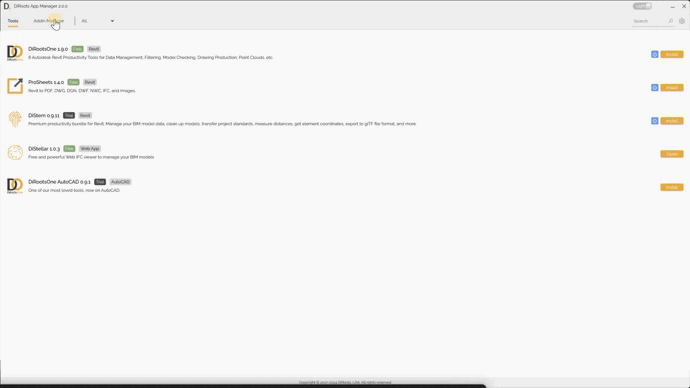
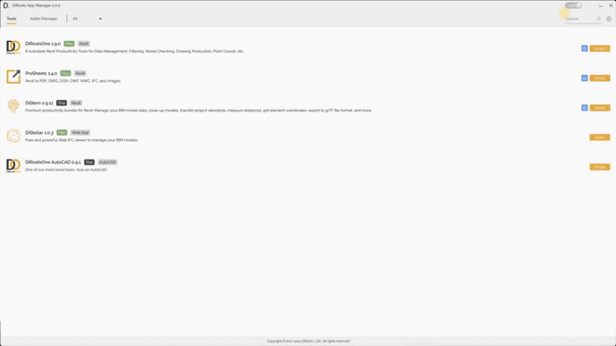

# Addin Manager
{: .no_toc }

In this tab, you can review the plug-ins installed on your computer, check their versions and installation locations, and manage their active status.

## Table of contents
{: .no_toc .text-delta }

1. TOC
{:toc}

---

- Use the switch in the On/Off column to activate or deactivate a plug-in.
- Use the search box to find a plug-in.

Close Revit and AutoCAD before activating or deactivating plug-ins.
{: .warning }

Run App Manager as an administrator before changing plug-in status. Without administrator permissions, those actions may fail.
{: .important }

Screenshots may show an earlier version of App Manager.
{: .note }

---

## Settings

Use these settings to control cleanup of old Revit journal files.

1. Enable **Auto delete Revit journal files** to make the cleanup settings available.

2. Set how many days old journal files must be before they are eligible for cleanup.

3. Choose how often App Manager checks for eligible files.

Cleanup deletes journal files that meet the age threshold you set.
{: .warning }

Screenshots may show an earlier version of App Manager.
{: .note }
