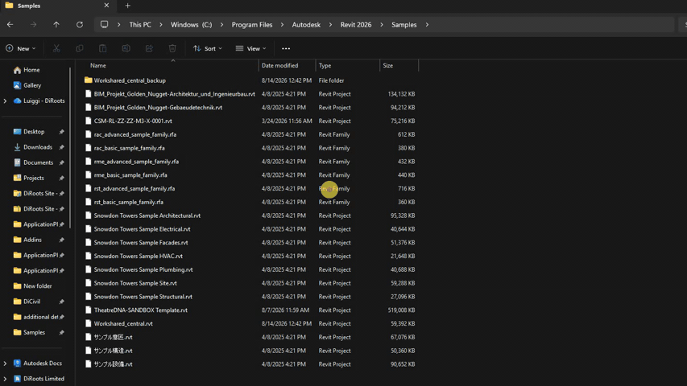
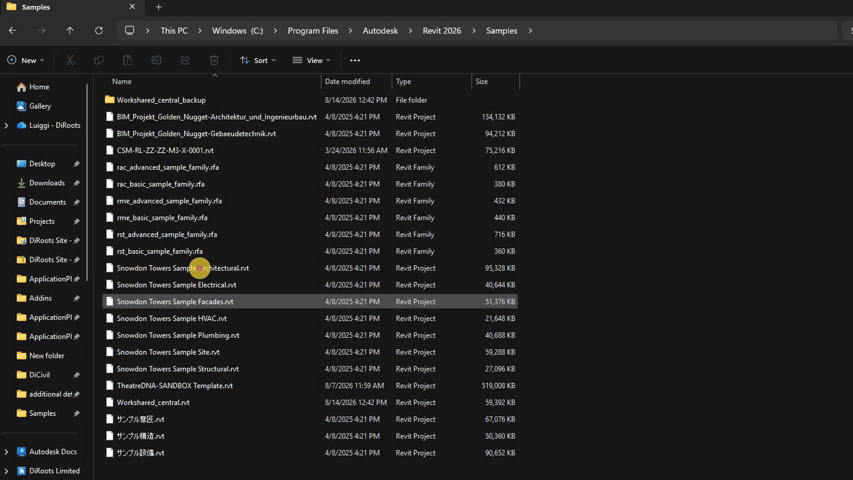
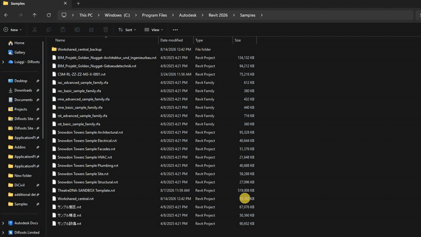
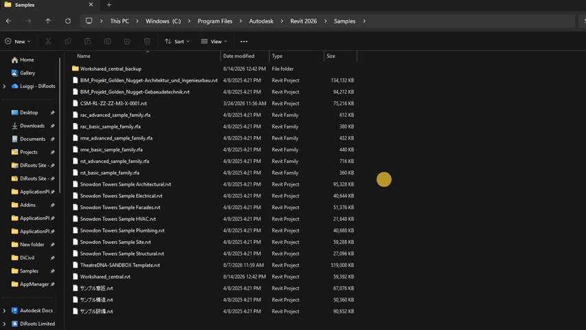

# DiRoots Context Menu
{: .no_toc }

Use the Windows context menu to check RVT and RFA file versions and open files with the appropriate Revit version.

## Table of contents
{: .no_toc .text-delta }

1. TOC
{:toc}

---

## Check Revit version

You can check the Revit version of one or more files after selecting them. From the same window, you can also choose the Revit version to open each file.

1. Select one or more RVT or RFA files, or right-click a single file.

2. Right-click the selection and click "Show more options".

3. Find "DiRoots" and then click "Check Revit version".

4. Review the Revit version for each selected file. From there, choose the Revit version to open any file if needed.

{: .note }
Screenshots may show an earlier version of App Manager.

## Open Revit file with the correct Revit version

Use this option to open an RVT or RFA file with the Revit version the file requires.

If the required Revit version is installed and the file is not workshared, the file opens directly. Otherwise, App Manager shows options to select the Revit version and, when needed, additional workshared settings.

1. Right-click the RVT or RFA file.

2. Click "Show more options".

3. Find "DiRoots" and then click "Open Revit file with the correct Revit version".

{: .note }
Screenshots may show an earlier version of App Manager.

## Support for workshared files

When opening files through DiRoots App Manager, you can see whether a file is workshared and choose how to open it:

- As a central file
- As a local file
- As a detached file

This is supported when using **Check Revit version** or **Open Revit file with the correct Revit version**, for one or more files.

{: .note }
Screenshots may show an earlier version of App Manager.

## Open in audit mode

You can open files in Audit mode. Audit mode always opens the file in a new Revit session.

This option is available from the same open flow when checking the Revit version or in specific cases of using Open Revit file with the correct Revit version.

{: .note }
Screenshots may show an earlier version of App Manager.
