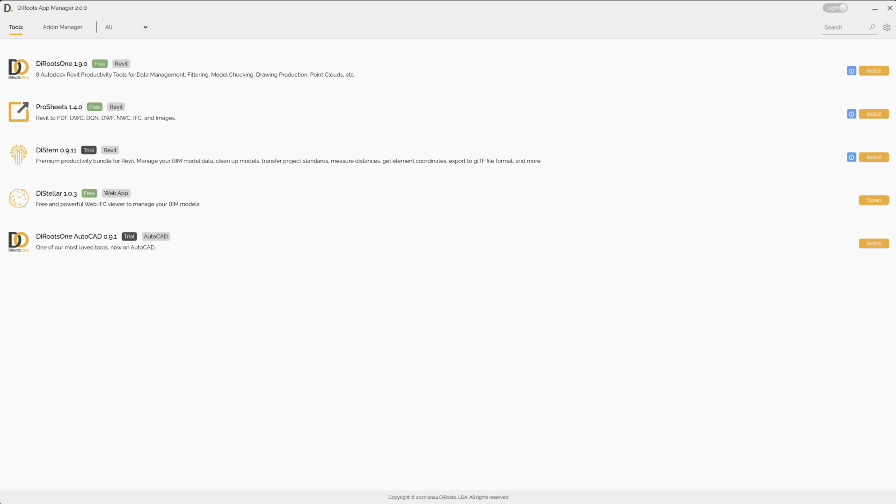
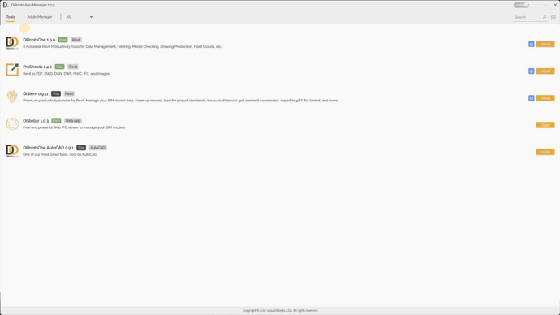
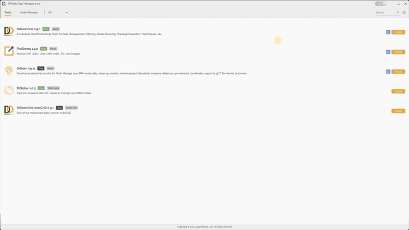
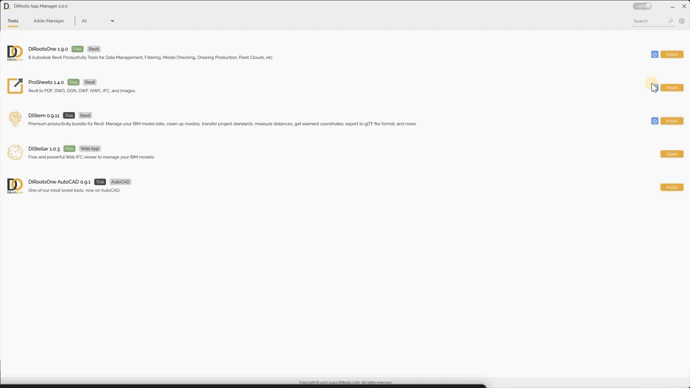

# App Manager
{: .no_toc }

DiRoots App Manager helps you install and update DiRoots applications, manage Revit plug-ins, and work with RVT and RFA files.

## Table of contents
{: .no_toc .text-delta }

1. TOC
{:toc}

---

## Tools

In the Tools tab, you can browse the DiRoots applications available in App Manager.

{: .note }
The label beside each tool name identifies its application type and whether it is free or requires a subscription.

- Use the search box to find a tool.
- Use the drop-down list to filter tools by type.

{: .note }
Screenshots may show an earlier version of App Manager.

### Tool details

Select a tool to view its features.

1. In the Overview tab, review the tool's main features and links to its documentation, feedback form, and custom software request form.

2. In the Changelog tab, review recent updates, new features, and bug fixes.

{: .note }
Screenshots may show an earlier version of App Manager.

### User guide

Select the Info button to open the documentation and tutorial videos for the selected tool.

{: .note }
Screenshots may show an earlier version of App Manager.

### Status

The button beside Info shows whether the application is installed or, for cloud applications, opens it. Statuses include Install, Uninstall, Update, and Open.

{: .warning }
If the button says Update, the installed application is out of date and may not include all current features.

{: .note }
Screenshots may show an earlier version of App Manager.

---

## Settings

Use these settings to control cleanup of old Revit journal files.

1. Set how many days old journal files must be before they are eligible for cleanup.

2. Choose how often App Manager checks for eligible files.

{: .warning }
Cleanup deletes journal files that meet the age threshold you set.

{: .note }
Screenshots may show an earlier version of App Manager.
